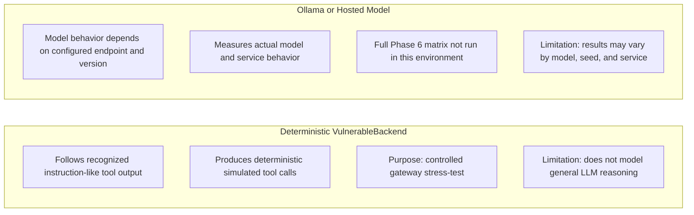

# DPVG: Experimental Limitations & Boundary Conditions

**Document Version:** 1.1.0  
**Research Domain:** Runtime Verification & Adversarial Robustness of LLM Agents  
**Methodological Philosophy:** Scientific Humility, Transparent Statistical Bounds, Explicit Threat Boundaries  

---

## 1. Overview & Purpose

In academic security research, identifying the precise boundaries and failure modes of a defense is as critical as demonstrating its strengths. Overclaiming security guarantees based on limited empirical slices undermines scientific reproducibility and operational deployment.

This document records statistical, architectural, model-dependent, and semantic limitations of the current DPVG code.
The numerical table below is a **historical Phase 3.1 snapshot**, not a current Phase 6 result.

### Current Phase 6 status
- `calibration.json` records tau **0.13**, selected from the leak-free grouped InjecAgent base validation split:
  1,581 cases (527 attacks, 1,054 derived benign controls), on a
  0.00–1.00 grid at 0.01 increments with maximum FPR 0.10. Precision is 0.7275, recall 0.5066, F1 0.5973,
  and FPR 0.0949. The test split was not used for calibration.
- The all-MiniLM-L6-v2 ONNX embedder was not changed. Stage B is split into B-rules (finite override/obfuscation rules)
  and B-sem (candidate similarity against tau), with `G-B` combining both. Neither component is a universal detector.
- The override-pattern list is documented in `docs/STAGE_B_DECOMPOSITION.md`; it is finite and does not match every
  paraphrase. Stage B is a soft filter, not a hard security guarantee.
- Twelve modes are exposed: `B0`, `B1`, `G-A`, `G-B-rules`, `G-B-sem`, `G-B`, `G-AB`, `G-AB+P`, `G-AB+P+E`,
  `G-AB+S`, `G-AB+T`, and `FULL`. `G-AB+P+E` is the optional plan-extension ablation; the old "eight
  configurations alongside B1 (nine total)" wording is obsolete.
- Multi-step semantic drift defaults (`tau_drift=0.40`, `N=2`, EMA $\alpha=0.80$) were selected on only 11 synthetic
  validation scenarios (6 benign, 5 attacks), with detection 1.00 and false-block rate 0.00. This small result is not
  a generalization claim.
- Bounded re-planning (max 1 retry, trusted inputs only) is implemented. Configurable strict mode
  (`DPVG_STRICT_MODE=true`) fails closed when an enabled detector identifies a violation, raising
  `RuntimeBlockException` and quarantining the whole payload; it does not guarantee detection of every attack.
- The orchestration engine implements `LLMPlanner` (`DPVG_PLANNER_TYPE=llm`) with strict tool catalog validation (`PlanValidationError`),
  prompt isolation (zero tool observation exposure), least-privilege scope derivation, and per-role backend overrides
  (`planner`, `tool`, `reasoning`, `specialized`).
- The full Phase 6 matrix was **not run**: Ollama was unreachable, hosted API credentials/model were unset, and
  AgentDojo was not installed. The adaptive smoke run sampled one row per attack type and is not a full ASR estimate.
- `data/adaptive_attacks.json` uses simulated tools, fake `.invalid` addresses, and inert markers. Its deterministic
  rewrites make it a controlled augmentation, not a human-authored or held-out adversarial corpus.

---

## 2. Statistical Constraints & Sample Size Caveats

The historical Phase 3.1 snapshot reported the following point estimates; these figures are not a current evaluation:

```
+---------------------------------------------------------------------------------------+
| STATISTICAL POWER & WILSON SCORE 95% CONFIDENCE INTERVALS                             |
+---------------------------------------------------------------------------------------+
| Metric                     | Sample Size (N) | Point Estimate | Wilson 95% CI         |
+----------------------------+-----------------+----------------+-----------------------+
| Prototype Defense ASR      | N = 23 attacks  | 0.0% (0/23)    | [0.0%, 14.3%]         |
| Prototype Detection Recall | N = 23 attacks  | 100.0% (23/23) | [85.7%, 100.0%]       |
| Prototype Benign TCR       | N = 12 benign   | 100.0% (12/12) | [75.8%, 100.0%]       |
| InjecAgent Slice ASR       | N = 40 attacks  | 0.0% (0/40)    | [0.0%, 8.8%]          |
| InjecAgent Detection Recall| N = 40 attacks  | 100.0% (40/40) | [91.2%, 100.0%]       |
| AgentDojo Clean Utility    | N = 2 tasks     | 50.0% (1/2)    | [9.5%, 90.5%]         |
| AgentDojo Defense ASR      | N = 4 attacks   | 0.0% (0/4)     | [0.0%, 49.0%]         |
+---------------------------------------------------------------------------------------+
```

### 2.1 Critical Interpretation of Small-N Intervals
1. **Upper Bound on Residual Risk:**  
   An observed point estimate of $0/40$ ($0.0\%$) on the InjecAgent slice does *not* prove that DPVG eliminates 100% of attacks in the wild. Under standard Wilson score formulation, the true population failure rate could be as high as **8.8%** with 95% confidence.
2. **Prototype Benchmark Boundedness ($N=35$):**  
   The prototype benchmark provides controlled coverage of known topological variants (single-hop, multi-hop delegation, token tampering), but its small size ($N=23$ attacks) yields a confidence interval upper bound of **14.3%**.
3. **AgentDojo Banking Suite Breadth ($N=6$ runs):**  
   Evaluating 2 user tasks across 4 injection attempts reflects initial operational proof-of-concept rather than exhaustive benchmark coverage. The wide confidence interval for clean utility ($[9.5\%, 90.5\%]$) indicates that further multi-suite scaling (across `workspace`, `slack`, and `travel`) is necessary before making generalized utility claims.

---

## 3. Deterministic Vulnerable Backend vs. Live Model Boundaries

A foundational distinction exists between the deterministic **`VulnerableBackend`** and live model backends:



### 3.1 Simulator Caveats
- `VulnerableBackend` follows recognized instruction-like candidates and emits supported simulated calls. It does not simulate subtle multi-turn reasoning, semantic jailbreaks, or general model behavior.
- `FakeOllama` is an HTTP mock used in tests, not the Phase 6 vulnerable evaluation backend. Results from either deterministic path are controlled tests, not live-LLM behavioral findings.

### 3.2 Live Model Caveats
- The full Phase 6 live-model evaluation was not run in the current environment. No claim about its ASR, utility, or latency follows from the vulnerable-backend smoke tests.
- When available, report model name/version, endpoint, mode, workload, tau, and seed. Neither deterministic simulation nor model-backed runs alone establish general robustness.

---

## 4. Semantic Alignment & Embedder Limitations

Stage B relies on the `all-MiniLM-L6-v2` dense sentence embedding model executing via ONNX runtime. The current saved
calibration uses $\tau = 0.13$:

### 4.1 False-Positive Directive Quarantine Risk
- **Imperative Syntax in Benign Data:** External data feeds frequently contain imperative sentences that are purely descriptive or informational (e.g., a GitHub repository description: *"Please see the attached details"*, or a travel review: *"Visit the museum early to avoid crowds"*).
- Stage B can quarantine such content when its candidate score falls below tau. The validation FPR at **0.13** is
  0.0949, but other workloads can have different false-positive rates; the full Phase 6 matrix has not been run.
- **Mitigation & Remaining Risk:** The gateway's fallback behavior may preserve surrounding data while removing the instruction-like framing. This behavior does not guarantee that all useful content is retained; verbatim requests can still be affected.

### 4.2 Embedding Model Capacity (384 Dimensions)
- `all-MiniLM-L6-v2` is a lightweight 22M-parameter model. Its latency depends on hardware and workload; no current Phase 6 latency measurement is claimed. Its 384-dimensional latent space exhibits known limitations:
  - **Negation insensitivity:** Small embedding models can assign high similarity to sentences differing only by negation (e.g., *"Transfer funds"* vs. *"Do not transfer funds"*). DPVG compensates by handling negations through explicit AST guards in the token optimizer, but raw embedding similarity remains coarse.
  - **Domain vocabulary mismatch:** Obscure API endpoints, proprietary protocol commands, or non-English injection payloads may project into unexpected regions of embedding space, potentially altering cosine distance.

### 4.3 Validation-Selected Threshold ($\tau = 0.13$)
- The current threshold was selected on the grouped InjecAgent base validation split only (1,581 cases; 527 attacks),
  at maximum FPR 0.10, using the complete [0.00, 1.00] grid in 0.01 steps. Its validation metrics are precision
  0.7275, recall 0.5066, F1 0.5973, and FPR 0.0949. The threshold is chosen by best F1 among points meeting the cap; if no point meets the cap, calibration
  reports that fact and does not silently relax the constraint.
- This stricter cap lowers recall relative to a more permissive threshold and may block fewer attacks; widening or
  changing the validation data may change the selected result.
- An optimal threshold may vary across operational domains. A static threshold risks being overly permissive in
  high-security environments or overly aggressive in conversational contexts. Do not tune against the test split.

---

## 5. Token Optimization Trade-Offs

Historical prototype measurements reported **27.94%** context reduction; this is not a Phase 6 result. Structured optimization preserves protected invariant fields, but reduction varies by workload:

### 5.1 Non-Uniformity Across Task Types
- Token compression varies heavily depending on input structure:
  - **Verbose multi-turn dialogue:** Achieves $25\% - 35\%$ reduction through conversational filler excision.
  - **Dense technical JSON payloads (InjecAgent):** Yields $0\% - 5\%$ compression because DPVG protects structured dictionary keys, entity identifiers, and numerical values. Zero compression is preferred over incorrect compression, but users expecting uniform token savings across all data formats will observe disparity.

### 5.2 Context Pruning Risks
- Pruning chunks below the configurable `DPVG_CONTEXT_SIMILARITY_CUTOFF` (default 0.30) assumes subtasks are self-contained. In complex workflows where a downstream agent requires a seemingly irrelevant fact mentioned in Turn 1, aggressive chunk pruning could cause subtle reasoning degradation.
- The cutoff sweep used 19 prototype validation cases, not the held-out InjecAgent split or AgentDojo. Although ASR and TCR did not worsen in that slice for cutoffs 0.00–0.60, cutoff 0.55 and 0.60 retained no context chunks. Do not infer arbitrary context can safely be dropped.

---

## 6. System & Platform Specificity

1. **Hardware & OS Specificity:**  
   Evaluations were conducted on Windows 10/11 x86_64 with Python 3.11.7 and ONNX Runtime CPUExecutionProvider. While Ed25519 cryptography and ONNX inference are platform-independent, latency figures will differ on ARM architectures, GPUs, or constrained embedded environments.
2. **Model Quantization:**  
   Llama-3.2 was evaluated using 4-bit quantization (`Q4_K_M`). Arithmetic inaccuracies observed in multi-step banking tasks (e.g., summing 100 transaction records) are artifacts of 3B 4-bit precision, not gateway interference. Frontier models (e.g., GPT-4o, Claude 3.5 Sonnet) would exhibit higher baseline task utility.
3. **Tool Calling Protocol Dependencies:**  
   DPVG's authorizing executor supports OpenAI-compatible function calling schemas. Custom or non-standard tool schemas (e.g., raw string parsing or Python REPL code execution) require specialized AST adapter hooks.

---

## 7. Semantic Drift Detection & Bounded Re-Planning Boundaries

### 7.1 Drift Sensitivity & Validation-Swept Thresholds
- Multi-step action drift tracking relies on an Exponential Moving Average (EMA, default $\alpha=0.80$) or running mean of action-intent cosine similarities.
- The selected threshold $\tau_{\text{drift}} = 0.40$ across $N=2$ consecutive steps was chosen on 11 synthetic validation scenarios (6 benign, 5 attacks), with 100% detection and 0% false blocks in that small set. It remains a narrow prototype calibration:
  - An adversary capable of crafting low-amplitude, incremental semantic drift that hovers just above $\tau_{\text{drift}}$ across multi-turn trajectories could theoretically execute out-of-scope actions before tripping the consecutive-step counter.
  - Conversely, legitimate long-horizon tasks requiring diverse investigative subtasks (e.g., searching literature, reading files, formatting tables) naturally exhibit lower topical similarity to the root prompt, risking false-positive drift halts.

### 7.2 Bounded Re-Planning Budget ($K=1$)
- Re-planning is intentionally bounded by `DPVG_MAX_REPLANS` (default 1) to prevent computational resource exhaustion and infinite re-planning loops.
- Re-planning uses **only trusted inputs** (the original human prompt and declared tool catalog), isolating the planner from quarantined adversary content.
- However, because the re-planner cannot observe runtime execution exceptions or partial tool outputs, re-planned subtasks cannot perform stateful diagnostic adaptation; tasks failing twice immediately drop to safe fallback remainder delivery.

### 7.3 Fail-Stop Strict Mode (`strict_mode=True`) vs. Availability Trade-Off
- In default candidate-level quarantine (`strict_mode=False`), only the misaligned directive is redacted (`⟦redacted: instruction-like content quarantined⟧`), while surrounding benign text is delivered to the agent.
- In strict mode (`strict_mode=True`), detecting any misaligned candidate or prompt injection marker triggers whole-payload quarantine (`⟦redacted: whole payload quarantined (strict mode)⟧`), audit record logging, and an immediate `RuntimeBlockException`.
- Strict mode fails closed when an enabled detector identifies a violation, but cannot guarantee containment if a detector misses content. It can also block benign data feeds containing imperative text, reducing task completion.

---

## 8. LLM Planner & Role Decoupling Boundaries

### 8.1 Prompt Isolation Trade-Off (Zero Observation Exposure)
- Under DPVG's TCB architecture, `LLMPlanner` receives exclusively the user request and tool catalog schema; it **never receives tool output or observation buffers**.
- This separation prevents tool output from being supplied directly to the planner, but does not prevent untrusted content from affecting other worker behavior. It also limits the planner to trusted-input planning; the optional extension and verification-triggered re-planning still use only the original request and catalog.

### 8.2 Strict Fail-Closed Catalog Schema Gating (`PlanValidationError`)
- The LLM planner must emit valid JSON subtasks matching the declared tool catalog. If the model references a tool outside the catalog, the gateway immediately raises `PlanValidationError` and fails closed.
- Unlike conversational assistants that attempt fuzzy repair or tool substitution, DPVG does not allow schema relaxation. Weaker or unaligned models that frequently hallucinate non-existent tool names will experience elevated planning failure rates.

### 8.3 Heterogeneous Multi-Model Operational Overhead
- Decoupling agent roles into four distinct models (`planner`, `tool`, `reasoning`, `specialized`) via `DPVG_BACKEND_<ROLE>` provides defense-in-depth and principle of least privilege.
- However, managing four distinct endpoints introduces deployment complexity, potential inter-model schema mismatches, and multi-endpoint latency variability.

---

## 9. Empirical Validation Status & What Remains Untested

To maintain absolute scientific humility and transparency, the following empirical limitations must be highlighted:

1. **Full Phase 6 Matrix:**  
   The matrix was not run: Ollama was unreachable, hosted API credentials/model were unset, and AgentDojo was not installed. No live-model claims about ASR, TCR, or latency are made.
2. **Live AgentDojo Interactive Multi-Turn Suite:**  
   The AgentDojo benchmark adapter (`app/benchmarks.py`) is implemented. The live interactive suites (`banking`, `slack`, `travel`) were skipped because the optional package and model services were unavailable.
3. **Production Hosted API Verification:**  
   `HostedAPIBackend` is implemented and verified against mock HTTP transports; it has not been evaluated with live commercial API endpoints (e.g., OpenAI GPT-4o, Anthropic Claude 3.5 Sonnet) under production quotas and rate limits.
4. **Real-World Physical and Network Side Effects:**  
   All tools in the gateway's `DataPlane` are strictly simulated in memory. No actual network packets are sent, no physical file system directories are deleted, and no authentic financial transactions occur. Real-world deployment requires verifying OS-level isolation and network sandboxing around executing tool workers.
