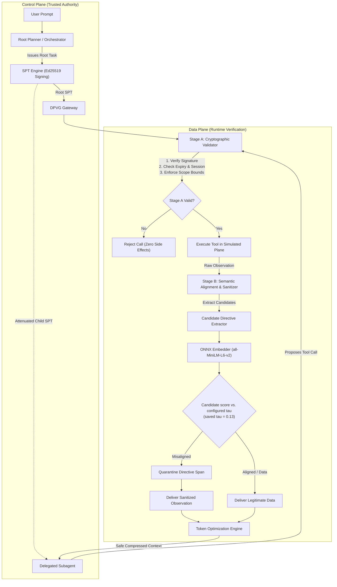

# DPVG: Dual-Plane Runtime Verification Gateway — System Design & Architecture

**Document Version:** 1.1.0  
**Target Architecture:** Multi-Agent LLM Systems  
**Primary Security Goal:** Zero-Trust, Token-Optimized Defense Against Indirect Prompt Injection  
**Reference Implementation:** DPVG v1.0.0 (Python 3.11 / Ed25519 / ONNX `all-MiniLM-L6-v2`)

---

## 1. Architectural Overview & Design Philosophy

The **Dual-Plane Runtime Verification Gateway (DPVG)** is a defense-in-depth security architecture designed to prevent indirect prompt injection (IPI) attacks and privilege escalation in multi-agent Large Language Model (LLM) workflows. 

Traditional LLM agent architectures operate under an ambient authority model: once an agent is granted access to tools (e.g., database queries, email transmission, file modification, wire transfers), any prompt injection embedded within untrusted external data (such as web pages, third-party emails, or customer reviews) can hijack the agent's execution flow and trigger arbitrary tool calls.

DPVG replaces ambient authority with a **dual-plane zero-trust verification model**:
1. **Control Plane (Cryptographic Scoped Provenance):** Operates out-of-band to generate, sign, attenuate, and verify cryptographically sealed capabilities (**Scoped Provenance Tokens**, or **SPTs**) via Ed25519 digital signatures.
2. **Data Plane (Semantic Alignment & Quarantine):** Inspects tool observations routed through the adapter before delivery to the agent, extracts candidate directives, scores their alignment with the authorized user goal, and quarantines or sanitizes detected content.
3. **Structured Token Optimization Engine:** Compresses conversational history and observation buffers while preserving protected security constraints, negations, amounts, and identifiers.



---

## 2. Dual-Plane Separation

### 2.1 Control Plane
The Control Plane is responsible for policy formulation and capability delegation. It never parses untrusted external observations. Its components include:
- **`SPTEngine` (`app/spt.py`):** Holds the master Ed25519 private key (or session-specific keypair). Issues the root token for the initial task and mints attenuated child tokens when tasks are delegated.
- **`TokenStore` & Revocation Registry:** Maintains the active token tree, tracking session IDs, token identifiers, nonces, parent-child relationships, and revocation status.
- **Lineage Tracker:** Records executed delegation hops independently from tool scope. Planned sibling subtasks derive their scope from the root; a genuinely nested delegation is additionally bounded by its immediate parent. Lineage itself does not narrow scope.

### 2.2 Data Plane
The Data Plane intercepts tool interactions routed through the DPVG adapter. It does not provide universal process- or OS-level mediation. Its components include:
- **`DPVGAuthorizingExecutor` / `Gateway` (`app/gateway.py`):** Intercepts tool calls emitted by LLM backends before execution. Evaluates the call against the presented SPT.
- **`CryptoValidator` (`app/validator.py`):** Reconstructs the canonical byte representation of the SPT and verifies the Ed25519 signature against the public key, validating expiration timestamps, replay nonces, session identifiers, and scope permissions.
- **`CandidateExtractor` & `QuarantineEngine` (`app/alignment.py`):** Parses raw tool observations to detect imperative sentences, concealed prompt injection tags (e.g., `<INFORMATION>`, `[SYSTEM]`), zero-width Unicode characters, HTML comments, and markdown blockquotes.
- **`AlignmentEngine` (`app/alignment.py`):** Separates B-rules (configured override patterns and obfuscation handling) from B-sem (candidate similarity against the root user intent using the `all-MiniLM-L6-v2` ONNX embedder). The saved base validation calibration is $\tau=0.13$ under a maximum FPR of 0.10. Stage B is a soft filter, not a hard guarantee.
- **`TokenOptimizer` (`app/token_opt.py`):** Performs structured pruning of conversational filler, drops semantically irrelevant chunks, and preserves security policies, negations, financial limits, and tool constraints.

---

## 3. Runtime Verification Pipeline (FULL Mode)

In FULL mode, tool calls routed through the gateway follow these phases. B0 intentionally bypasses gateway checks;
other ablation modes disable selected checks. The built-in tool plane is simulated, and external integrations can
bypass this adapter unless they route calls through it.

```mermaid
sequenceDiagram
    autonumber
    participant Agent as LLM Agent
    participant Gateway as DPVG Gateway
    participant Crypto as Stage A (CryptoValidator)
    participant Tool as Tool Runtime
    participant Align as Stage B (AlignmentEngine)
    participant Opt as Token Optimizer

    Agent->>Gateway: Propose Tool Call (tool_name, args, SPT)
    Gateway->>Crypto: Validate Token (Signature, Expiry, Session, Depth, Scope)
    alt Stage A Fails (Tampered, Expired, or Out-of-Scope)
        Crypto-->>Gateway: Validation Failure
        Gateway-->>Agent: Rejection Message (Zero Side Effects)
    else Stage A Succeeds
        Crypto-->>Gateway: Authorized
        Gateway->>Tool: Execute Tool (tool_name, args)
        Tool-->>Gateway: Raw Observation Data
        Gateway->>Align: Inspect Observation (Candidate Directives)
        Align->>Align: Score candidate vs. root intent (saved tau = 0.13)
        alt Misaligned Directive Found
            Align-->>Gateway: Quarantine Misaligned Spans (Safe Fallback)
        else All Data Aligned / Benign
            Align-->>Gateway: Raw Data Verified
        end
        Gateway->>Opt: Compress Context (Structured Protection)
        Opt-->>Agent: Deliver Sanitized & Optimized Observation
    end
```

### Detailed Pipeline Stages:
1. **Tool Call Interception:**  
   The runtime hooks into the LLM execution loop (via `DPVGAuthorizingExecutor` in AgentDojo or the DPVG gateway handler in standalone agent loops). The tool call name, arguments, and associated SPT are captured before any runtime function is dispatched.
2. **Cryptographic Integrity & Lineage Validation (Stage A):**  
   The `CryptoValidator` parses the SPT. It verifies:
   - Valid Ed25519 signature using the trusted authority's public key.
   - Current UTC timestamp does not exceed `expires_at`.
   - The token's `session_id` strictly matches the active runtime session (preventing cross-session injection replay).
   - Delegation depth $d \le d_{max}$ (preventing unbounded delegation loops).
   - The token nonce has not been previously consumed in the replay cache.
3. **Scope & Least-Privilege Enforcement (Stage A):**  
   The gateway checks whether `tool_name \in \text{allowed\_tools}`. If the token enforces read-only constraints (e.g., `read_only=True`), write or mutative operations (e.g., `send_money`, `delete_file`) are rejected immediately.  
   **Invariant:** Rejection terminates the pipeline without executing the tool function. Zero side effects occur on the system.
4. **Tool Execution & Observation Interception:**  
   If admission checks authorize the call, the tool is executed by the built-in simulated tool plane. The raw result is intercepted before being written into the LLM's message history.
5. **Candidate Extraction & Semantic Alignment (Stage B):**  
   The `AlignmentEngine` inspects the observation payload:
   - Strips obfuscation techniques (zero-width Unicode sequences, hidden HTML comment tags `<!-- ... -->`, embedded style blocks).
   - Extracts all candidate imperative directives using regex grammar (`extract_candidates`).
   - For each candidate sentence $s_i$, calculates cosine similarity:
     $$\text{Sim}(s_i, \text{goal}) = \frac{\mathbf{e}_{s_i} \cdot \mathbf{e}_{\text{goal}}}{\|\mathbf{e}_{s_i}\|_2 \|\mathbf{e}_{\text{goal}}\|_2}$$
   - B-rules and B-sem can be ablated independently; combined G-B enables both. Candidate scores are checked against $\tau=0.13$ from the leak-free base validation split (`calibration.json`). Explicit configured override patterns are matched independently of $\tau$, but neither component catches all attacks.
6. **Quarantine & Safe Fallback Delivery:**  
   Misaligned instruction-like spans are quarantined or sanitized before delivery. Sanitization aims to preserve surrounding observation data, but cannot guarantee zero legitimate data loss or task failure.

### 3.1 Ablation Mode Boundaries

The API and dashboard expose the same component matrix as `app/gateway.py::MODES`:

| Mode | Enabled components |
|---|---|
| `B0` | None; bypasses the gateway |
| `B1` | Datamark spotlighting only |
| `G-A` | Stage A only |
| `G-B-rules` | B-rules only |
| `G-B-sem` | B-sem only |
| `G-B` | Stage B only |
| `G-AB` | Stage A + Stage B |
| `G-AB+P` | G-AB + trusted-plan gating |
| `G-AB+P+E` | G-AB + plan gating + optional extension using trusted request and catalog only |
| `G-AB+S` | G-AB + intent-derived scope + trusted-plan gating + side-effect argument checks |
| `G-AB+T` | G-AB + token optimization only |
| `FULL` | G-AB + scope + trusted-plan gating + argument checks + token optimization |

The `G-AB+T` comparison against `G-AB` therefore isolates token optimization. Historical reports generated with the
older mode mapping are not token-optimization-only comparisons.

---

## 4. Scoped Provenance Tokens (SPT)

### 4.1 Token Structure
An SPT is an immutable, cryptographically signed capability represented by canonical JSON fields:

```json
{
  "token_id": "spt-8f92a10b-449e-4c8d-8a21-123456789abc",
  "parent_token_id": "spt-root-0001",
  "session_id": "sess-live-20261112",
  "agent_id": "finance_worker_agent",
  "allowed_tools": ["get_balance", "get_transaction_history"],
  "depth": 1,
  "max_depth": 6,
  "constraints": {
    "read_only": true,
    "max_amount": 0.0
  },
  "issued_at": 1731420000,
  "expires_at": 1731420300,
  "nonce": "a7f4e912bc09",
  "root_hash": "e3b0c44298fc1c149afbf4c8996fb92427ae41e4649b934ca495991b7852b855",
  "signature": "3b6a2e4...ed25519_hex_bytes..."
}
```

### 4.2 Cryptographic Attenuation Rules
When an agent delegates a subtask, the `SPTEngine` mints a child token $T_c$. Its scope is derived from the root token, while lineage separately records executed delegation hops:

1. **Root-Bounded Tool Restriction:**
   $$\text{allowed\_tools}(T_c) \subseteq \text{allowed\_tools}(T_0)$$
   A child agent cannot be granted a tool outside the root scope. Planned sibling subtasks derive scope from the root, not from the prior sibling's token; a genuinely nested child is also bounded by its immediate parent. Lineage chaining is an audit trail and does not narrow tool scope.
2. **Depth Bound Enforcement:**
   $$\text{depth}(T_c) = \text{depth}(T_p) + 1 \quad \text{subject to} \quad \text{depth}(T_c) \le \text{max\_depth}$$
   Any delegation exceeding $\text{max\_depth}$ fails closed.
3. **Constraint Propagation:**
   $$\text{constraints}(T_p) \subseteq \text{constraints}(T_c)$$
   If $T_p$ has `read_only = true`, $T_c$ must have `read_only = true`. A child cannot relax restrictions imposed by an ancestor.
4. **Session & Root Lineage Binding:**
   $$\text{session\_id}(T_c) = \text{session\_id}(T_p) \quad \land \quad \text{root\_hash}(T_c) = \text{root\_hash}(T_p)$$
   Tokens cannot be migrated across sessions or attached to an alternate root tree.

---

## 5. Semantic Alignment & Quarantine Engine

### 5.1 Validation-Selected Threshold ($\tau$)
Semantic alignment relies on `all-MiniLM-L6-v2` ONNX embeddings. The current saved calibration is $\tau=0.13$,
selected from the grouped InjecAgent base validation split (1,581 cases; 527 attacks) using a 0.00–1.00 grid at
0.01 increments and maximum FPR 0.10. Validation precision is 0.7275, recall 0.5066, F1 0.5973, and FPR 0.0949.
The test split is held out. Embeddings are one soft-filter signal, not a security proof.

### 5.2 Quarantine Modes: Candidate-Level (Default) vs. Strict Whole-Payload Quarantine
DPVG provides two quarantine strategies configured via `DPVG_STRICT_MODE`:

1. **Candidate-Level Quarantine (Default Mode, `strict_mode=False`):**
   Rather than discarding the entire tool observation upon detecting an injection attempt (which causes severe task completion failure), DPVG isolates only the malicious directive span. The remainder of the payload (the *safe fallback remainder*) is delivered to the agent:
   - In B-sem mode, candidates scoring below $\tau$ are sanitized; in B-rules mode, candidates matching configured override patterns are sanitized. G-B combines these independent decisions.
   - Structured fields and benign surrounding text are preserved where possible and delivered to the agent.
   - The execution pipeline does not fail-stop; instead, it delivers safe fallback data or triggers a bounded re-plan.

2. **Strict Mode (`strict_mode=True`):**
   Provides fail-stop behavior when an enabled detector identifies a violation:
   - Upon detecting any misaligned directive or prompt injection marker, the **entire payload** is quarantined (`⟦redacted: whole payload quarantined (strict mode)⟧`).
   - An audit record is immediately appended to the audit log with the detection point, stage, rejection code, reason, and similarity score.
   - A `RuntimeBlockException` is raised, terminating execution to prevent any potential second-order leakage or partial-observation exploitation.

### 5.3 Multi-Step Semantic Drift Detection & Re-Plan Feedback Loop (Step 6)
1. **Multi-Step Drift Detection:**
   Tracks the alignment of executed or proposed actions to the root intent across multi-hop agent trajectories using either Exponential Moving Average (EMA, $\alpha=0.80$ by default) or running mean:
   $$\text{DriftScore}_t = \alpha \cdot \text{Sim}(a_t, \text{goal}) + (1-\alpha) \cdot \text{DriftScore}_{t-1}$$
   If the drift metric falls below `DPVG_DRIFT_THRESHOLD` (default 0.40) for `DPVG_DRIFT_CONSECUTIVE_STEPS` (default 2) consecutive steps, execution is blocked and re-planning is triggered (or `RuntimeBlockException` in strict mode). These defaults were selected on 11 synthetic validation scenarios and are not broadly validated. Drift scores are recorded in both the verification decisions table and event log.

2. **Re-Plan Feedback Loop:**
   On a verification block, DPVG runs a bounded re-planning cycle (up to `DPVG_MAX_REPLANS`, default 1 retry) through intent optimization (Step 1), root re-registration (Step 2), and delegated orchestration (Step 3).
   - **Trusted Input Invariant:** Re-planning uses **only trusted inputs** (the original user query and trusted specification). Quarantined tool observations or adversary payloads are never admitted into the re-planning loop.
   - **Safe Fallback:** If re-planning retries are exhausted without successful verification, the gateway falls back to safe fallback delivery.

---

## 6. Structured Token Optimization Engine

Token optimization in DPVG operates under strict zero-trust preservation rules. Pruning conversational filler must never compromise security guarantees:

### 6.1 Structured Protection Categories
The following lexical and semantic categories are protected from compression:
1. **Explicit Security Policies:** Phrases defining permitted or prohibited actions (e.g., *"Do not delete files"*, *"Never disclose credentials"*).
2. **Negations & Conditional Invariants:** Words such as `not`, `never`, `except`, `unless`, `without`.
3. **Financial Limits & Amounts:** Currency symbols, quantities, and numeric thresholds (e.g., `\$5,000`, `25%`, `limit: 100`).
4. **Entity Identifiers:** UUIDs, email addresses, usernames, URLs, and repository paths.
5. **Tool Permissions & Schema Arguments:** Names of allowed tools and their exact signature requirements.

### 6.2 Pruning Mechanics
- Conversational filler sentences (e.g., *"I hope this helps!"*, *"Sure thing, let me assist you with that today."*) are identified and excised.
- Chunks below the configurable `DPVG_CONTEXT_SIMILARITY_CUTOFF` (default 0.30) to the current subtask can be pruned from context.
- If compression threatens semantic equivalence ($\text{Sim}(\text{query}_{\text{orig}}, \text{query}_{\text{opt}}) < 0.45$), the optimizer falls back to the original text. Zero compression is preferred over lossy compression.

---

## 7. Component Summary Table

| Component | File Path | Plane | Primary Responsibility |
| :--- | :--- | :---: | :--- |
| `SPTEngine` | `app/spt.py` | Control | Issues, attenuates, and cryptographically signs Ed25519 capability tokens. |
| `CryptoValidator` | `app/validator.py` | Control/Data | Validates signatures, expiration, replay nonces, and delegation depth. |
| `DPVGAuthorizingExecutor` | `app/gateway.py` | Data | Intercepts tool calls, verifies SPT scope, prevents unauthorized execution. |
| `AlignmentEngine` | `app/alignment.py` | Data | Runs separate B-rules and B-sem checks; B-sem uses the configured threshold (saved $\tau=0.13$). |
| `CandidateExtractor` | `app/alignment.py` | Data | Extracts candidate directives and strips evasion techniques (Unicode/HTML/markdown). |
| `TokenOptimizer` | `app/token_opt.py` | Data | Performs structured filler removal and context pruning while preserving invariants. |
| `LLMPlanner` & `RulePlanner` | `app/orchestrator.py` | Control | Decomposes requests into validated subtasks gated by the tool catalog. |
| `DPVGDojoContext` | `app/benchmarks.py` | Test/Bench | Integrates DPVG into the AgentDojo benchmark suite with ground-truth tool permissioning. |

---

## 8. LLM Planner, Tool Catalog Gating, and Per-Role Backends

### 8.1 LLM-Backed Planner & Tool Catalog Schema Gating
DPVG supports both an LLM-backed planner (`LLMPlanner`) and a deterministic rule-based planner (`RulePlanner`), selectable via `DPVG_PLANNER_TYPE="llm"` or `Gateway(planner_type="llm")`:
- **Tool Catalog Enforcement:** The planner receives ONLY the user request and the catalog of authorized tools (e.g., `ALL_TOOLS` or the case-level `allowed_tools` specification).
- **Strict Fail-Closed Validation:** The generated plan must parse as valid JSON subtasks (`text`, `tool`, `args`). If the LLM generates a subtask referencing a tool not present in the allowed catalog, the gateway strictly raises `PlanValidationError` without falling back to rule planning, failing closed before any capabilities or tokens are minted.
- **Rule Fallback:** On transient network or JSON syntax failures (when not a catalog validation error), the planner falls back to the deterministic `RulePlanner` when `fallback_to_rule=True`.

### 8.2 Least-Privilege Scope Derivation
The root token scope `S(root)` is derived strictly from the validated plan:
$$S(\text{root}) = \text{tools}(\text{Plan}_{\text{validated}}) \cap \text{DeclaredTools}$$
- If a user requests *"Search the web for research papers"*, the validated plan names only `search_web`.
- As a consequence, `send_email`, `transfer_money`, `delete_file`, etc. are entirely absent from `S(root)`.
- Delegated child tokens attenuate strictly from `S(root)`: $S(\text{child}) \subseteq S(\text{parent})$.
- If an agent or injection attempts to invoke `send_email`, the presentation fails at Stage A (`StageAResult(False, "scope")`) with zero tool execution and zero side effects.

### 8.3 Per-Role Backend Architecture
DPVG assigns distinct agent specifications and models to four operational roles:
1. **`planner` (`llm-d`):** Plans subtasks from trusted intent; uses `DPVG_BACKEND_PLANNER`.
2. **`tool` (`llm-a`):** Executes read-only and standard tools (`read_email`, `get_calendar`, `read_file`, `search_web`); uses `DPVG_BACKEND_TOOL`.
3. **`reasoning` (`llm-b`):** Performs text summarization and handoff analysis without tools; uses `DPVG_BACKEND_REASONING`.
4. **`specialized` (`llm-c`):** Handles high-privilege side-effect operations (`send_email`, `transfer_money`, `delete_file`, `post_slack`); uses `DPVG_BACKEND_SPECIALIZED`.

All roles default to the shared backend (`DPVG_BACKEND`), but can be independently overridden via environment variables or programmatically via `Gateway(role_backends={...})`.

### 8.4 Planner Isolation Invariant (Zero Observation Exposure)
Under the DPVG architecture, the planner is strictly isolated from the data plane:
- The planner is invoked exclusively during Step 2 (Root Intent Registration) and bounded re-planning (using only original user intent and trusted context).
- The planner **never receives tool output, raw observation buffers, or quarantined text**.
- Tool observations are routed exclusively to Stage B verification and subsequently to the executing agent (`tool`, `reasoning`, or `specialized`).

---

## 9. Evaluation Matrix & Reproducibility Harness (`scripts/run_matrix.py`)

### 9.1 Matrix Dimensions
The DPVG evaluation harness coordinates a multi-dimensional benchmarking grid:
$$\text{Modes} \times \text{Backends} \times \text{Workloads} \times \text{Seeds}$$
- **Modes:** Twelve configurations: `B0`, `B1`, `G-A`, `G-B-rules`, `G-B-sem`, `G-B`, `G-AB`, `G-AB+P`, `G-AB+P+E`, `G-AB+S`, `G-AB+T`, and `FULL`.
- **Backends:** Local deterministic (`vulnerable`), local real weights (`ollama` with `llama3.2`), and hosted chat completions (`hosted`).
- **Workloads:** `demo`, `injecagent_base`, `injecagent_enhanced`, `adaptive`, `drift`, and `agentdojo` (if installed).
- **Seeds:** 3 fixed random seeds (default: 17, 29, 43), with fixed sampling temperature 0.0.
- **Status:** Harness implemented; the full matrix was skipped in this environment because Ollama was unreachable, hosted credentials/model were unset, and AgentDojo was not installed.

### 9.2 Fine-Grained Scenario Taxonomy
Each workload case is mapped to fine-grained scenario rows:
1. `benign`: Clean benign tasks (measuring TCR and False Positive Rate).
2. `static injection`: Direct imperative instruction overrides embedded in tool observations.
3. `forged token`: Adversarial presentation of forged SPT signatures.
4. `tampered token`: Capabilities modified post-issuance (privilege escalation).
5. `expired token`: Capability tokens presented after TTL expiry.
6. `replayed token`: Intercepted request nonces presented in a second invocation.
7. `wrong_root token`: Cryptographic SPT tokens bound to a different root intent.
8. `adaptive/camouflaged`: Semantically aligned or topically disguised injections.
9. `multi-hop handoff propagation`: Injections intended to traverse across delegated subagent handoffs.

### 9.3 Statistical Reporting & Latency Overhead
Across random seeds, the harness computes:
- $\text{ASR} = \frac{\sum \text{attack\_success}}{N_{\text{attack}}}$
- $\text{TCR}_{\text{benign}} = \frac{\sum (\text{completed} \land \neg\text{detected})}{N_{\text{benign}}}$
- $\text{TCR}_{\text{attack}} = \frac{\sum \text{completed}}{N_{\text{attack}}}$
- $\text{Precision}, \text{Recall}, \text{F1}, \text{FPR}$
- **Added End-to-End Latency vs. B0:**
  $$\Delta \text{Median} = \text{Median}(\text{Latency}_M) - \text{Median}(\text{Latency}_{B0})$$
  $$\Delta \text{P95} = \text{P95}(\text{Latency}_M) - \text{P95}(\text{Latency}_{B0})$$
- **Token Reduction ($R_{tok}$):**
  $$R_{tok} = 1 - \frac{T_{\text{opt}}}{T_{\text{base}}}$$
  calculated using real token metrics reported by the backend where available.

### 9.4 Provenance & Artifact Generation
- **Provenance Logging:** Writes one distinct JSON per run (`results/runs/{backend}_{workload}_seed{seed}_{timestamp}.json`) containing git commit, timestamp, seed, backend, model, and tau.
- **Graceful Skipping:** If a workload (e.g. `agentdojo`) or an external backend (e.g. unconfigured hosted API or offline Ollama) is unavailable, the harness writes a structured `{"status": "skipped", "reason": "..."}` entry without writing synthetic/placeholder data or terminating the grid.
- **Summary Table Generation:** Automatically compiles `results/summary_table.md`, `results/summary_table.csv`, `results/scenarios_table.md`, and `results/scenarios_table.csv` for publication.
